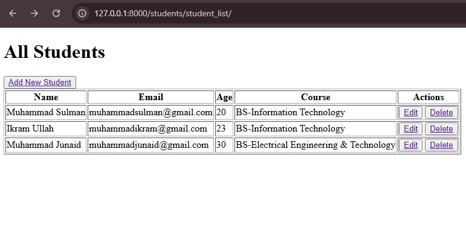
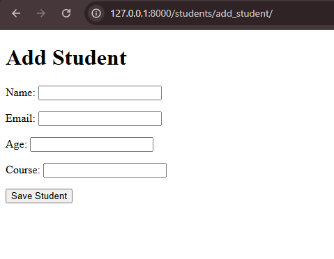
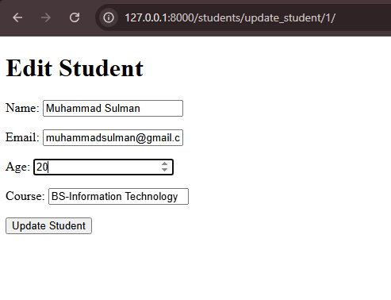
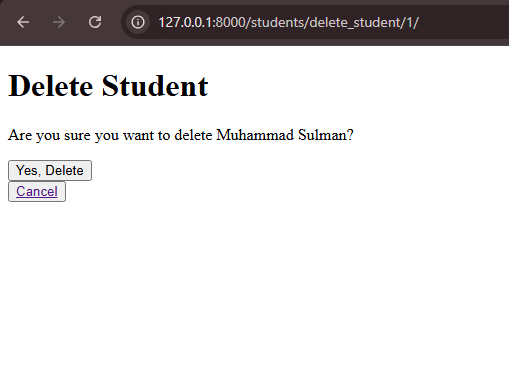

# Student Management System using DJANGO

**Developed by Muhammad Sulman**

## 📸 Project Screenshots

### 🏠 Home Page

---

### ➕ Add Student

---

### ✏️ Update Student

---

### 🗑️ Delete Student

---

## 📖 Overview

Student Management System is my first Django project, built using **Python, Django, and Django ModelForm**.

It is a CRUD-based web application that allows users to manage student records through a simple and user-friendly interface.

The application supports creating, viewing, updating, and deleting student records using Django's ModelForm functionality.

## ✨ Features

- ➕ Add New Student
- 📋 View All Students
- ✏️ Update Existing Student Records
- 🗑️ Delete Student Records
- 📝 Django ModelForm Integration
- ✅ Form Validation
- 🔄 CRUD Operations
- 🔗 Dynamic URL Routing
- 🎨 Simple User Interface

## 🛠️ Tech Stack

### Backend
- Python
- Django
- Django ModelForm

### Frontend
- HTML5

### Database
- Django Model Database

### Tools
- VS Code
- Git
- GitHub

## 👨‍💻 Author

**Muhammad Sulman**

BSIT Student | Django Backend Developer

---

⭐ If you like this project, don't forget to give it a star!